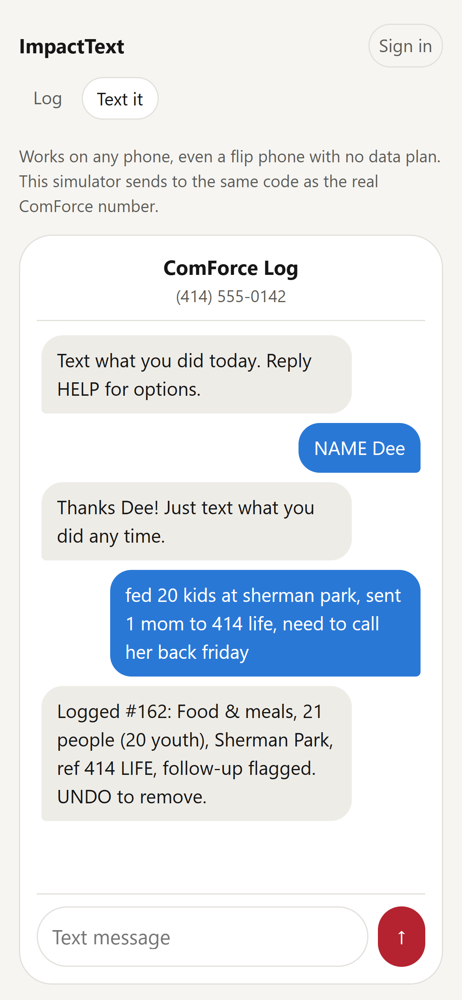
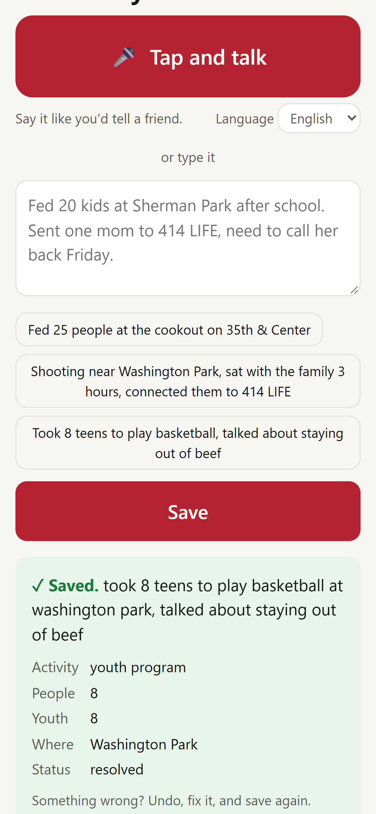
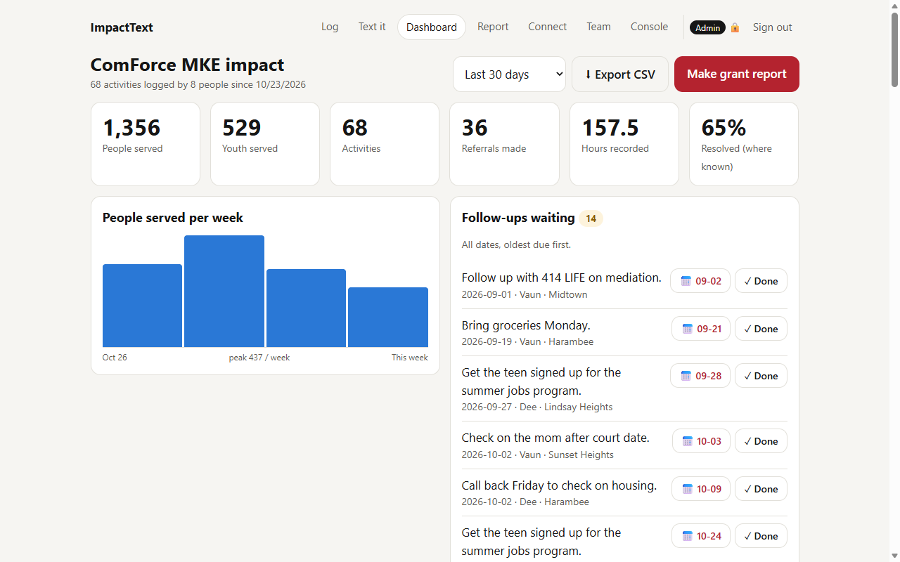
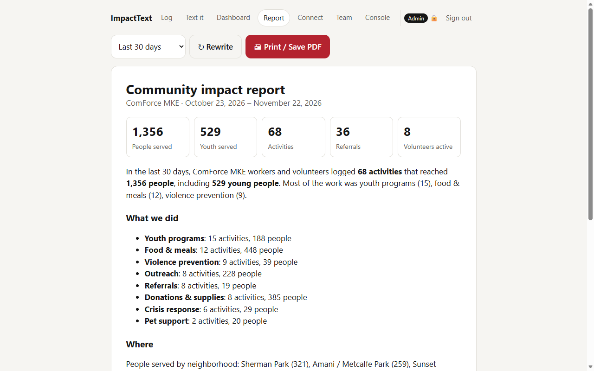

# ImpactText

**Text it, say it, or type it. We do the paperwork.**
Hacksgiving 2026 · Track 03: Data Collection & Impact Measurement · built for ComForce MKE (Community Task Force Milwaukee)

ComForce MKE workers do crisis response, violence prevention and youth work on Milwaukee's north side. They're out in the neighborhood, not at a desk, and funders judge their programs on data that nobody has time to write down.

ImpactText lets a worker log what they did the way they'd tell a friend:

> *"fed 20 kids at sherman park, sent 1 mom to 414 life, need to call her back friday"*

That one line becomes a clean record (activity, people served, youth, neighborhood, referral, follow-up). It shows up on a dashboard and rolls into a funder-ready impact report with one click.

| Text from any phone | Or tap and talk | Admin dashboard | One-click grant report |
|---|---|---|---|
|  |  |  |  |

*All data shown is synthetic.*

## What Track 03 asked for, and what we built
| The track asks to… | ImpactText |
|---|---|
| **Simplify how workers document** their activities | Text a number (works on a flip phone), tap the mic and talk (English or Spanish), or type. No app to install, no account, no training. One sentence is enough. |
| Let them **keep ownership of their records** | One SQLite file and a one-click CSV export that ComForce keeps. A live link feeds Google Sheets and Excel. Workers who sign in can see and fix their own notes. |
| **Measure outcomes** | People and youth served, referrals by partner, hours, neighborhoods, and resolved vs. open follow-ups. Follow-ups show up in Google, Outlook and Apple calendars. |
| **Communicate impact** | **Make grant report** writes a printable, Save-as-PDF report from the numbers. It can also be emailed to ComForce automatically every month. |

## Try it (about 2 minutes)
Python 3.13, from the repo root:
```powershell
python -m venv .venv; .\.venv\Scripts\Activate.ps1
pip install -r requirements.txt
python -m app.seed                # ~160 synthetic demo entries over 90 days
uvicorn app.main:app --reload     # prints a made-up admin password
```
Then open http://127.0.0.1:8000:
1. **`/`** Type a note, or tap **Tap and talk** in Chrome or Edge and say one. It's saved and broken into fields at once.
2. **`/phone`** The SMS simulator, which runs the same code a real text does. Try `NAME Dee`, then a note, then `ME` or `UNDO`. In Spanish: `AYUDA`, or a note like *dimos comida a 20 niños en sherman park*.
3. **`/dashboard`** Sign in as `admin` with the printed password. Admins must use two-step sign-in, so scan the QR code with any authenticator app. To skip that, start the server with `ADMIN_TOTP_SECRET=JBSWY3DPEHPK3PXP` (a demo-only key) and get the code with `python -c "from app import mfa; print(mfa.code_now('JBSWY3DPEHPK3PXP'))"`.
4. **Make grant report → Print / Save PDF.**

It works with no API key: a free keyword reader fills in the fields. Add `ANTHROPIC_API_KEY` to `.env` (see `.env.example`) and Claude reads the notes and writes the report.

## How it works
```
Text (Twilio) ──┐
Voice (browser) ┼─> scrub personal details ─> Claude, strict JSON schema ─> SQLite ─> dashboard · report · CSV · calendars
Typed note ─────┘                             └─ keyword rules if there's no key or the AI is down
```
- **The AI only fills in fields.** Every number in the report comes from the database, and the report prompt forbids inventing figures.
- **Privacy first.** Phone numbers, emails, street addresses and titled names ("Ms. Johnson") are removed *before* a note is stored or sent to the AI. Entries about violence are flagged sensitive and kept out of report stories.
- **Built for the field.** It never fails if the AI does: the keyword reader still saves the note. A double-sent text counts once. Notes typed with no signal wait on the phone and send themselves later, keeping the day they happened.
- **Two sides.** Workers never need an account. Admins see everything, and admin sign-in requires a second step (an authenticator app code).

Every page, command and safeguard is described in **[docs/FEATURES.md](docs/FEATURES.md)**.

## Measured
| | Result |
|---|---|
| Fields right on held-out notes, free keyword reader | **91.1%** (first version: 65%). Same on dictation-style notes. [Details](docs/EXPERIMENTS.md) |
| Fields right with Claude | run `python -m eval.run_eval --ai` with a key (about 60 notes, a few cents) |
| Odd and hostile inputs, privacy scrubbing | 66/66 |
| Sign-in, two-step and "who can open what" on every route | 139/139 |
| Calendars, spreadsheet links, phone app | 48/48 |
| Edits, retries, phone linking, Spanish texts, monthly email | 46 unit tests |
| Emulated iPhone, Android, small phone and desktop, light and dark | 46 checks, 120 page views |
| Text replies that fit in one SMS (one charge) | 70/70, English and Spanish |
| Load | 200 texts/sec, zero errors |

GitHub Actions runs all of this, plus a Docker build and smoke test, on every pull request.

## What it costs to run
About **$10/month** for one nonprofit: a small server with a disk (~$7), a Twilio number and texts (a few dollars), and AI reading of ~300 notes (~$2.50 on Claude Opus 5.5, ~$0.10 on Haiku 5.5). A demo runs at $0: no AI key, the `/phone` simulator, and `render.free.yaml`. Check current prices.

## Known limits / next
- Tested on emulated phones only so far. The mic and Add to Home Screen still need a pass on real devices.
- Real texting in the US needs Twilio A2P 10DLC registration, which takes days to weeks. Until then, use a trial number or the `/phone` simulator.
- A bare first name in a note isn't removed when the AI is off. The AI summary does rewrite names.
- One server and one SQLite file. That's right for one organization's team, but it isn't built to scale out.

## More
| Doc | For |
|---|---|
| [docs/FEATURES.md](docs/FEATURES.md) | Every feature, the admin vs. worker sides, privacy rules, integrations |
| [docs/PITCH.md](docs/PITCH.md) | The 4-minute pitch and demo script |
| [docs/EXPERIMENTS.md](docs/EXPERIMENTS.md) | How accuracy, privacy, robustness, load and SMS cost were measured |
| [docs/DEVELOPMENT.md](docs/DEVELOPMENT.md) | Local setup, code map, which test covers what |
| [docs/LAUNCH_CHECKLIST.md](docs/LAUNCH_CHECKLIST.md) · [docs/SMS_SETUP.md](docs/SMS_SETUP.md) | Putting it online for ComForce: hosting, admin setup, Twilio, email |
| [docs/DATA_CORRECTNESS.md](docs/DATA_CORRECTNESS.md) | Follow-ups, safe edits, duplicate-proof retries |

Deploy: `render.yaml` (paid plan with a disk, deploys gated by CI) or `render.free.yaml` (a $0 demo that re-seeds synthetic data on boot).

*Demo data is synthetic. No real ComForce records are in this repo.*
